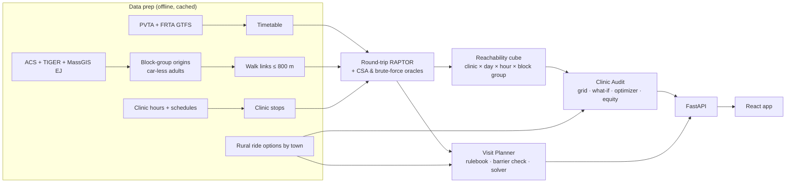

# CareLeap: Reachable Care

> **A referral is not a finished visit.** CareLeap shows western Massachusetts health
> systems which of their own appointments their patients **physically can't get to by
> bus**, and then plans the high-stakes visits so they actually happen.

**Built for Hackachusetts 2026** · Healthcare & Biotech · Challenge 3: *Improving healthcare
access and coordination*

`Python 3.12` · `RAPTOR in NumPy` · `OR-Tools CP-SAT` · `FastAPI` · `React + MapLibre + D3` · `Hypothesis` · `Kiro`

---

## The problem

About **3.6 million Americans** miss or delay care each year because they can't get there
(Wallace et al.). The visits missed most often are the ones that matter most. After a
positive FIT stool test, **about half** of patients don't finish the follow-up colonoscopy
within six months (PubMed 39843790).

Clinic hours are set around staff and rooms, not around the bus. An 8:00am slot can sit
"on a bus route" and still be impossible: the first bus arrives at 8:20, or the last bus
home leaves ten minutes before the visit ends. Health systems see a no-show rate, not the
cause.

And the bus is only one barrier. A sedated colonoscopy needs an adult escort home, so a
bus-only plan never works. Rural Franklin County has almost no fixed-route data at all.

## What CareLeap does

Two modes run on one round-trip routing engine.

| | 🗓️ **Clinic Audit** | 🧭 **Visit Planner** |
|---|---|---|
| **For** | clinic ops managers, CHNA / community-benefit teams, ACO planners | referral coordinators, patient navigators |
| **Question** | *Which of our clinic hours can car-less neighbors reach, there and back?* | *Can this one high-stakes visit actually happen?* |
| **Shows** | a week grid (day × hour) of the share of car-less adults who can make the round trip, a map by block group, and an equity breakdown | a 6-question barrier check (transport, work shift, childcare, escort, cost, language) → a ranked plan |
| **Fixes** | drag a clinic block to a new hour and watch the grid recompute; "Suggest best schedule" ranks the best block moves | a reachable slot that fits the shift, an escort-aware ride with a MassHealth PT-1 pre-fill, a telehealth swap where allowed, an in-language prep sheet, and the last bus home |
| **Plus** | a rural lens: which towns have transit, only assisted rides, or nothing | a day-before itinerary on a phone preview, with a plan B |

### The demo story

1. **Baystate GI × Holyoke.** Open the audit, and the early-morning cells turn red. Hover
   one to see why in the day ribbon: outbound legs → visit → return legs → last bus home.
2. **Drag the block** from 8am to 10am. The grid recomputes and shows the change in
   percentage points. Or click **Suggest best schedule** for the optimizer's top moves. Every
   number is computed, never typed in.
3. **Maria** (a synthetic patient): Spanish-speaking, no car, works 7–3, positive FIT. The
   planner flags *"Needs an escort: transit won't work"*, picks a slot after her shift inside
   a volunteer-driver window, pre-fills the PT-1 ride, and attaches a Spanish prep sheet.

## How it works



**A cell is reachable** when both legs work for a visit starting at time `s` that lasts `d`
minutes:

- **Get there:** a walk + bus + walk trip arrives at the clinic by `s − 10 min` (check-in).
- **Get home:** a trip leaves the clinic at or after `s + d` and gets home the same day.
- **Within limits:** at most 2 transfers, at most 2 hours each way, at most 800 m of walking
  per leg.

**Reachable share** = car-less adults whose origin makes the round trip ÷ all car-less adults
in that community.

**The optimizer** moves clinic blocks within posted open hours to maximize reachable
visit-hours for environmental-justice (EJ) car-less adults, weighted by visit priority. It uses
lazy greedy (CELF), and an exact OR-Tools CP-SAT solve checks it on small cases.

**The planner** is a small constraint solver. Every visit rule (duration, escort, telehealth,
prep, recurrence) is data in [`planner/visit_rules.yaml`](planner/visit_rules.yaml), so it can
be audited and extended.

### What the real data shows

The audit covers **506 block groups** in Hampden, Hampshire and Franklin counties, and **4
clinics** chosen to span urban and rural care. Numbers below are from the cached cube (vintage
2026-10-24, PVTA feed of 2026-09, FRTA feed of 2026-08; method in
[`docs/methods.md`](docs/methods.md)):

| Clinic | Feed | Visit modeled | Share of car-less adults who can make the round trip |
|---|---|---|---|
| Baystate GI / Endoscopy, Springfield | PVTA | colonoscopy, 180 min | 31.0% |
| Holyoke Medical Center | PVTA | prenatal, 60 min | 33.4% |
| Mercy Medical Center, Springfield | PVTA | primary care, 30 min | 41.5% |
| CHCFC Greenfield (rural) | FRTA | colonoscopy, 180 min | **11.3%** |

- **Time of day matters.** The real-cube contract test pins an hourly share of 19% at 7am,
  45% at noon and 14% at 6pm.
- **Franklin County is almost unserved by fixed routes.** Only 5 of its 62 block groups have a
  bus stop within 800 m.
- **86 block groups (3,270 car-less adults)** can reach care only by an assisted ride
  (dial-a-ride, Council on Aging driver, or PT-1), not by bus.

Car-less adults are an estimate: adults × the block group's zero-vehicle household share (ACS
B25044). Walk time is straight-line × 1.3 at 80 m/min. Both are labelled as estimates in the app.

## Why you can trust the numbers

A wrong answer strands a patient, so the router is tested hard:

- **Three independent routers.** RAPTOR (production), Connection Scan, and a brute-force
  oracle agree on 240 random synthetic networks and on the real PVTA feed.
- **Property-based tests** (Hypothesis) for causality, FIFO, transfer limits, midnight safety
  (GTFS times past `24:00:00` are never wrapped), "never worse" optimizer results, and planner
  rules like *escort ⇒ never transit-only*.
- **Golden trips** hand-checked against the real PVTA and FRTA timetables.
- **Provenance everywhere.** Click any number in the app to open the "How we know this is
  right" drawer: source, vintage, requirement, and the tests guarding it.

These tests caught real bugs, including a case where **both test oracles were wrong** and only
the real network exposed it. See the Kiro Scorecard under "Built with Kiro" below.

## Data sources

| Data | What it gives us |
|---|---|
| [PVTA GTFS](https://www.pvta.com/g_trans/google_transit.zip) | Pioneer Valley bus stops, routes, timetables |
| FRTA GTFS ([Mobility Database mdb-429](https://mobilitydatabase.org/)) | Franklin County routes for the rural clinic |
| US Census ACS 5-year + TIGER | car-less households, population, age, language by block group |
| MassGIS Environmental Justice | EJ status and limited-English share |
| Posted clinic hours | real hours for the audited clinics (templates labelled as such) |
| FRTA, PVTA, Council on Aging, MassHealth pages | per-town rural ride options and PT-1 fields |
| CMS AHC HRSN tool, PRAPARE | basis for the barrier-check questions |

Every row in the manual data has a cited source. The full list is in [`docs/sources.md`](docs/sources.md).

## Run it

```bash
python -m venv .venv && source .venv/bin/activate
make install            # pip install -e ".[dev,pipeline]"
cp .env.example .env    # add CENSUS_API_KEY (free: api.census.gov/data/key_signup.html)

make data               # download raw sources (~35 MB) and build every cache (~5 min)
make test               # fast suite: unit + property + golden + contract (what CI runs)
make test-full          # + slow real-feed differential tests + full Hypothesis profile

CARELEAP_DATA=real make api   # API on :8000 against data/cache
make web                # Vite dev server on :5173 (run `cd web && npm install` first)
make dev                # both

make snapshot           # freeze data/cache -> data/snapshots/demo-v1/
make demo               # serve the API on that frozen snapshot
```

Without `make data` the API runs in **mock** mode (labelled mocks in `api/mocks/`). Then
`/suggest` and `/rural` answer "needs real data" instead of inventing numbers.

**Deploy.** The `Dockerfile` + `railway.json` run the API on Railway (`python -m api`, health
check `/health`) against the committed snapshot in `deploy/snapshot/`.

### API

| Endpoint | What it returns |
|---|---|
| `GET /clinics` | clinics the audit covers |
| `GET /audit` | week grid of reachable share for clinic × community × day, plus equity breakdown |
| `GET /audit/blockgroups` | per-block-group results for the map |
| `POST /whatif` | the same grid after moving a clinic block |
| `GET /suggest` | the optimizer's top-k schedule changes with their gain |
| `GET /rural` | rural verdict per block group: transit, assisted only, or none |
| `POST /plan` | a ranked Visit Planner plan from visit type + barrier answers |
| `GET /provenance` | source, vintage, requirement and tests behind an on-screen number |
| `GET /report` | CHNA-ready audit report, one page per clinic |

Shapes are fixed in [`docs/contracts.md`](docs/contracts.md) and pinned by contract tests.

## Repo layout

```
careleap/
├── engine/      GTFS ingest, RAPTOR, CSA, brute force, reachability cube, optimizer, equity
├── planner/     visit rules, barrier check, constraint solver, itinerary, EN/ES templates
├── api/         FastAPI: /audit, /whatif, /suggest, /plan, /rural, /provenance, /report
├── web/         React app: /audit, /planner, /about
├── pipeline/    builds the Parquet caches (origins, walk links, cubes)
├── mcp/         gtfs-mcp, reach-mcp, access-resources-mcp
├── power/       publishable Kiro power (power/careleap)
├── data/        raw/ + cache/ (git-ignored), manual/ + fixtures/ (committed)
├── tests/       unit, property, differential, golden, contract
├── docs/        contracts, methods, sources, decisions (ADRs), Kiro journals
└── .kiro/       steering, specs, hooks, agents, MCP config (always committed)
```

## Guardrails

- **Logistics only.** CareLeap never makes a clinical or eligibility decision. *Your care
  team decides your care.*
- **Synthetic patients only.** No real PHI anywhere.
- **Every number carries a source and vintage.** Template values are labelled "illustrative".
- **Patient text comes only from human-reviewed templates** (EN + ES), per 45 CFR 92.201(c)(3).
  No live machine translation goes to patients.
- **Reachability is not attendance.** We measure reachable visit-hours, not no-shows
  prevented. That's why the planner checks every barrier, not just the bus.

## Built with Kiro

We used Kiro across IDE, CLI, Crew and Web: 13 specs (requirements-first, design-first,
quick and bugfix), 11 steering files across all four inclusion modes, 11 hooks, 5 custom
agents, 3 custom MCP servers, and a Kiro power. The full story is in
[`KIRO_USAGE.md`](KIRO_USAGE.md) and the per-person journals in
[`docs/kiro-journal/`](docs/kiro-journal/).

<details>
<summary><b>Kiro Scorecard</b> (click to expand)</summary>

What each Kiro feature is, where it lives, and the concrete thing it caught or saved.
Test counts are current as of 2026-10-24 (evening): `make test` → **490 passed** (fast
suite), `make test-full` adds 2 slow real-feed differential tests (**492**); `cd web && npx
vitest run` → **20 passed** (5 files), Playwright e2e 2 + axe 2. A fresh copy of the tree
ran `make install && make data && make test` clean (`make data` = 5 min, 4 clinics). Every
number below is one we can reproduce in this repo.

| Kiro feature | Where in repo | What it caught or saved (concrete) |
|---|---|---|
| **Steering** | `.kiro/steering/*.md`, `AGENTS.md` | 11 always-on/scoped rules. `gtfs-domain.md` pins the midnight no-wrap rule (`24:30:00`→`88200`); `accessibility.md` drives the "no colour-only cells" web test; `tech.md` the provenance rule. Steering on/off writeup: [ADR 003](docs/decisions/003-experiment-3-steering-on-off.md). |
| **Specs — `raptor-router`** | `.kiro/specs/raptor-router/` | Authoritative router spec; RAPTOR shipped as the production path. |
| **Specs — `connection-scan`** | `.kiro/specs/connection-scan/` | Second-implementation (CSA) spec; the structural "second opinion" in the differential tests. |
| **Specs — `reachability-cube`** (Design-First) | `.kiro/specs/reachability-cube/` | 24 `RC-` reqs, 12/12 tasks (multi-clinic, parallel build, FRTA closed 2026-10-24). Documented + guarded the discarded profile-search shortcut (**1.2% flat vs true 31%** reachability). Cube now covers 4 clinics incl. CHCFC Greenfield over the merged PVTA+FRTA feed (11.3% reachable — the rural gap, measured). |
| **Specs — `schedule-optimizer`** (Requirements-First) | `.kiro/specs/schedule-optimizer/` | 16 `SO-` reqs, 9/9 tasks done; CELF greedy + CP-SAT oracle. 9 of 16 `SO-` ids cited directly in test code. |
| **Specs — `visit-planner`** | `.kiro/specs/visit-planner/` | Barrier-check + constraint-solver spec for high-stakes visits. |
| **Specs — `manual-data`** | `.kiro/specs/manual-data/` | Manual/synthetic data sourcing spec (provenance + vintage per number). |
| **Specs — `ui-week-grid`** | `.kiro/specs/ui-week-grid/` | Audit week-grid UI spec (drives the `web/` Audit screen). |
| **Specs — `bug-transfer-limit`** (Bugfix) | `.kiro/specs/bug-transfer-limit/` | Retroactive bugfix spec from the real PVTA counterexample (trip `4107`→`1053`: 4 out / 6 return buses, limit 3). |
| **Specs — `bug-csa-transfer-cap`** (Bugfix) | `.kiro/specs/bug-csa-transfer-cap/` | **Both test oracles were wrong.** Running the differential over the *real* feed (connection-scan task 6) showed CSA losing **21 stops** RAPTOR reached. Root cause: CSA *and* brute force kept one label per stop — invalid once transfers are capped (time × buses is bi-criteria). RAPTOR was right. Fixed CSA with per-level labels and brute force to settle per (stop, buses) state; minimal 5-stop trap feed pinned in `tests/property/test_csa_transfer_cap.py`, shown failing on pre-fix code and passing on the fix. |
| **Specs — `multi-feed`** | `.kiro/specs/multi-feed/` | PVTA + FRTA in one `Timetable` (agency-prefixed ids, per-feed calendars, ≤400 m cross-agency walks); 9/9 tasks incl. M1 review; golden FRTA Route 32 trip. |
| **Property-based tests** | `tests/property/` (36 tests) | `test_midnight.py` defends the ≥86400 no-wrap invariant; `test_transfer_limit.py` pins the shrunk `n=4` counterexample as `@example`; optimizer props assert never-worse + greedy ≥ (1−1/e)·CP-SAT. |
| **Differential tests** | `tests/differential/` (242 cases: 240 synthetic + 2 real-feed) | RAPTOR == CSA == brute-force oracle over **120 random feeds × 2** (reachability + earliest-arrival), **0 disagreements**. Caught 2 router bugs during bring-up (origin foot-transfers; CSA transfer-unlock). Then the **real-feed** run (`test_real_feed_agree.py`: 40 random PVTA round trips + 3 full earliest-arrival maps) caught the **oracle bug** above — two agreeing oracles were both wrong, and only the real network had the trap shape (long-first, short-later arrival at a hub). Lesson for the write-up: a differential test is only as strong as its inputs. Now **0 disagreements** on the real feed too. |
| **Golden trips** | `tests/golden/` (4 tests: 3 PVTA + 1 FRTA) | Real PVTA feed caught the **transfer-limit bug** the synthetic feeds never produced (RAPTOR boarded from same-round stops → >2 transfers). FRTA Route 32 golden trip pins the multi-feed loader. |
| **Contract tests** | `tests/contract/` (19 tests) + `tests/unit/test_rural_api.py` (7) | API shape + real-cube contract (hourly share not flat: 7am 19% → noon 45% → 6pm 14%). `/rural` contract pinned before the UI: verdict rule as a Hypothesis property; real data = 320 block groups transit-reachable, **86 assisted-only (3,270 car-less adults)**, 0 with nothing, 100 outside the rural table. |
| **Custom agents** | `.kiro/agents/*.json` | `router-dev`, `careleap-dev`, `audit-runner`, `content-reviewer`, `release-checker` — scoped tool/permission profiles + agent hooks. |
| **MCP servers** | `mcp/`, `.kiro/settings/mcp.json` | `gtfs-mcp` — **wired to real engine** (`round_trip`, `Timetable`). `reach-mcp` — **wired to real engine** (`engine.audit` + `engine.optimizer`, `suggest_schedule`). `access-resources-mcp` — **wired to the manual data** (`rural_options`, `pt1_prefill`, `visit_rules` + the rural table as a resource; M3). No stubs remain. |
| **Hooks** | `.kiro/hooks/` (IDE) + `.kiro/agents/careleap-dev.json` (CLI) — see [`.kiro/hooks/README.md`](.kiro/hooks/README.md) | **11 of 11 planned.** CLI (agent `careleap-dev`): #1 feed-freshness on `agentSpawn`, #2 template reminder, #3 block template writes without sign-off, #4 block live routing APIs (exit 2 → "use gtfs-mcp"), #5 provenance log. IDE (8 `.kiro.hook` files): #1 session-start feed expiry, #6 fast router suite on `engine/**` save, #7 axe on `web/**` save, #8 GTFS validate, #9 data freshness, #10 traceability, #11 two journal hooks. 35 script tests. File hooks fire only on agent edits, so CI repeats the checks. |
| **CI** | `.github/workflows/kiro-ci.yml` ([docs/ci.md](docs/ci.md)) | Jobs `test` (pytest + `kiro-cli agent validate`), `web` (tsc, vitest, Playwright e2e, axe), `release-gate` (headless `kiro-cli chat --no-interactive --agent release-checker`). The gate self-skips: kiro-cli 2.34.0 has no non-interactive login yet. Squash-merge kept a 6.5 MB data zip out of `main` (PR #7). |
| **Power** | `power/careleap/` | `plugin.json`, `mcp.json` (gtfs-mcp + reach-mcp via `CARELEAP_HOME`), 2 skills. Installed into a fresh empty workspace and driven over MCP stdio: `tools/list` + a real `round_trip` call passed. Found a real bug: the tool was exposed as `round_trip_tool`, not the contract name `round_trip` — fixed. Published as [SSJ-07/slot-to-stop-power](https://github.com/SSJ-07/slot-to-stop-power) v0.1.0 (under the project's old name). |
| **Crew** | `ops/crew/`, `docs/kiro-journal/` | Ran Phase A and Phase B as parallel agents on disjoint files (every claimed file/test re-checked). Two no-LLM script crons live: PVTA feed heartbeat every 6 h (ETag/Last-Modified diff → Slack) and a 14-day feed-expiry alarm. Slack alert pending Slack hookup. |
| **Kiro Web** | GitHub issues [#8](https://github.com/SSJ-07/hackachusetts/issues/8), [#9](https://github.com/SSJ-07/hackachusetts/issues/9), [#10](https://github.com/SSJ-07/hackachusetts/issues/10) | Issues opened for Kiro Web Autonomous (i18n, phone itinerary, QR card). PRs not yet opened — experiment ⑤. |

#### Experiments ①–⑤

| # | Experiment | Status | Writeup |
|---|---|---|---|
| ① | Differential oracle (RAPTOR vs CSA vs brute force) | **done** — 240 synthetic cases + real-feed run; caught 2 router bugs, then **a bug in both oracles** (`bug-csa-transfer-cap`) | [ADR 001](docs/decisions/001-raptor-vs-csa.md) |
| ② | Spec-driven vs vibe coding (UI legend vs grid) | **pending** — protocol + exact metrics fixed | [ADR 004](docs/decisions/004-experiment-2-spec-vs-vibe.md) |
| ③ | Steering ON vs OFF (`gtfs-domain.md`) | **done (single-sample, 1 confound)** — ON wrote & passed 12/12; OFF write-denied, its *proposed* code also passed 12/12 | [ADR 003](docs/decisions/003-experiment-3-steering-on-off.md) |
| ④ | Requirements-First vs Design-First specs | **done (single-sample)** — req-first stronger on req→test traceability (9/16 vs 0/24 cited in tests) | [ADR 002](docs/decisions/002-experiment-4-req-first-vs-design-first.md) |
| ⑤ | Kiro IDE vs Kiro Web Autonomous | **pending** — protocol + exact metrics fixed | [ADR 005](docs/decisions/005-experiment-5-ide-vs-web-autonomous.md) |

</details>
